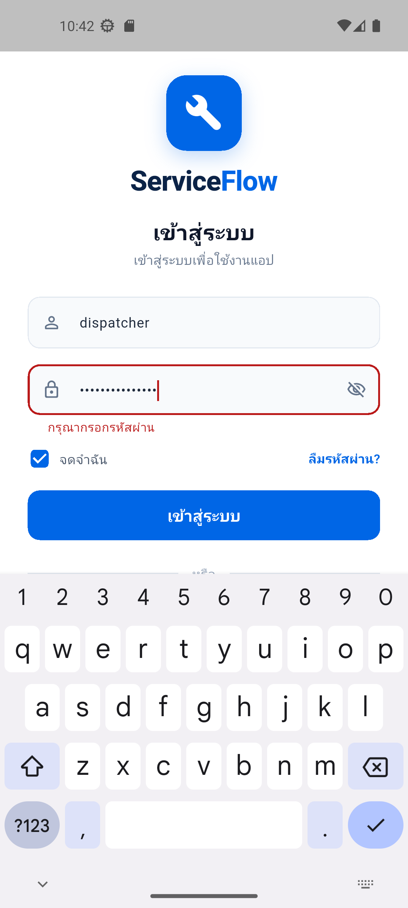
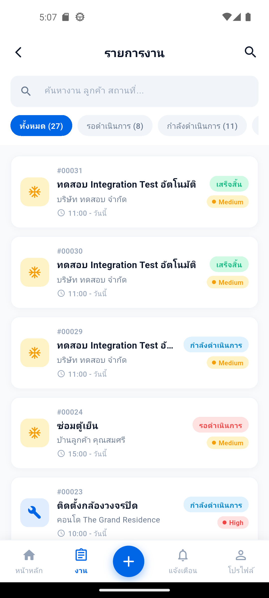
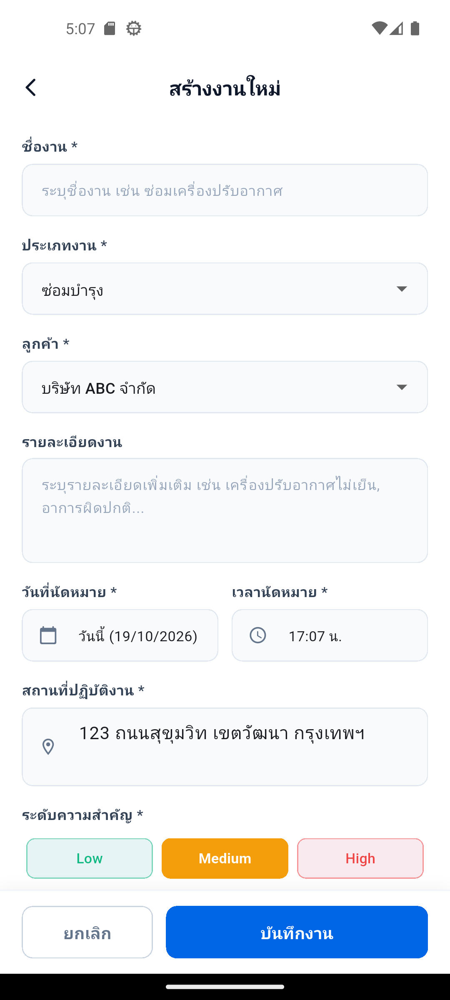
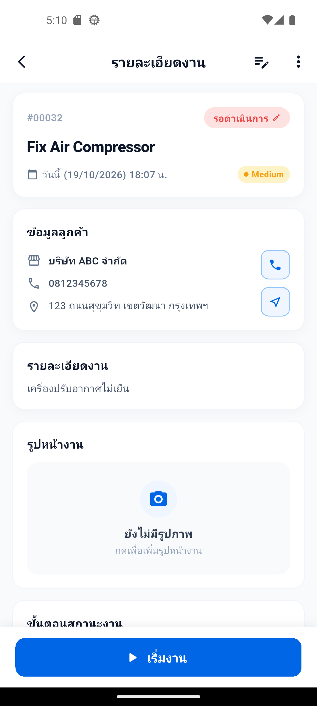
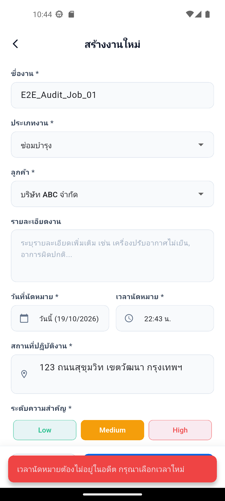
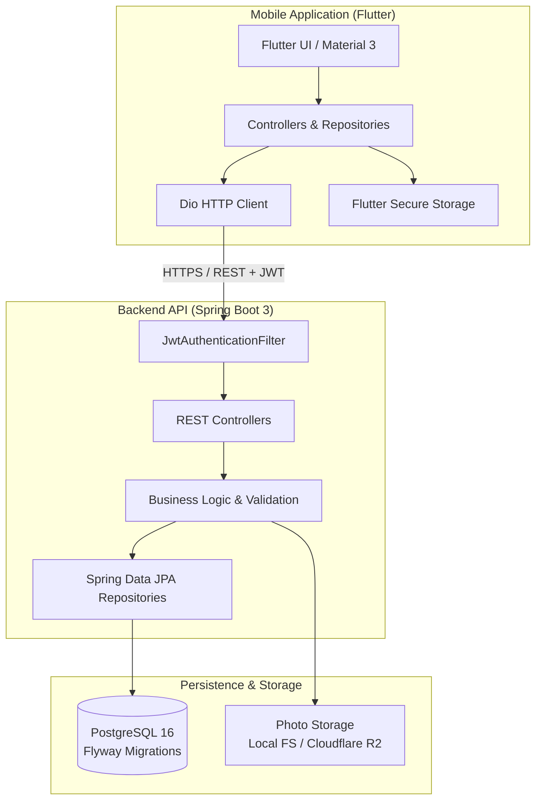

# ServiceFlow

ServiceFlow is a comprehensive field service and job management platform designed to streamline dispatching, work order tracking, and field technician operations. The solution consists of a cross-platform mobile client built with **Flutter** and a scalable RESTful backend service powered by **Java 21**, **Spring Boot 3**, and **PostgreSQL**.

---

## 📱 Application Screenshots

| Dispatcher Dashboard | Technician Job List | Create Service Job |
|:---:|:---:|:---:|
|  |  |  |

| Job Details & Actions | Job Created Confirmation |
|:---:|:---:|
|  |  |

---

## 🌟 Key Features

### 1. Job & Work Order Management
- **Lifecycle Tracking**: Strict state transitions (`ASSIGNED` ➔ `IN_PROGRESS` ➔ `COMPLETED` / `CANCELLED`).
- **Priority & Categorization**: Support for Low, Medium, High, and Urgent priorities across multiple job types (Repair, Maintenance, Inspection, Installation).
- **Technician Assignment**: Dispatchers can assign and reassign work orders to available technicians.
- **Photo Documentation**: Technicians can upload and manage work verification photos with secure multipart streaming.

### 2. Authentication & Role-Based Access Control (RBAC)
- **Stateless JWT Security**: Secure JSON Web Token authentication with HMAC-SHA256 signing.
- **Granular Roles**:
  - `ROLE_ADMIN`: User management, global configuration, system auditing.
  - `ROLE_DISPATCHER`: Job creation, scheduling, status overview, and technician dispatching.
  - `ROLE_TECHNICIAN`: Personalized job queue, status updates, time tracking, and photo documentation.
- **Secure Local Storage**: Mobile client stores authentication tokens securely via platform keystore / Keychain using `flutter_secure_storage`.

---

## 🏗️ Architecture & Technology Stack



### Technology Matrix

| Layer | Technology | Description |
|:---|:---|:---|
| **Mobile Client** | Flutter 3.x, Dart 3.x | Cross-platform mobile client (Android / iOS) |
| **Networking** | Dio | HTTP client with token interceptors and error handling |
| **Mobile Storage** | flutter_secure_storage | Encrypted token and credential storage |
| **Backend Framework**| Java 21, Spring Boot 3.3.4 | High-performance enterprise REST API |
| **Security** | Spring Security 6, jjwt | Stateless JWT authentication and role-based authorization |
| **Database** | PostgreSQL 16 | Relational database with Flyway versioned migrations |
| **Object Storage** | Local File System / Cloudflare R2 | Storage provider for job attachment photos |
| **API Docs** | Springdoc OpenAPI (Swagger UI) | Interactive REST API documentation |

---

## 📁 Repository Layout

```text
serviceflow/
├── lib/                         # Flutter mobile application
│   ├── config/                  # API endpoints and environment configuration
│   ├── controllers/             # UI state and authentication controllers
│   ├── core/                    # Network client, interceptors, and secure storage
│   ├── models/                  # Domain entities (Job, User, JobPhoto, Statistics)
│   ├── repositories/            # Data layer and remote API integrations
│   ├── screens/                 # Mobile views (Dashboard, Jobs, Detail, Photos, Login)
│   ├── services/                # Device services (Image picker, camera)
│   └── widgets/                 # Reusable UI components
├── serviceflow-backend/         # Spring Boot 3 backend application
│   ├── src/main/java/           # Application controllers, services, entities, security
│   ├── src/main/resources/      # application.yml, profiles, and Flyway migrations
│   ├── src/test/java/           # Unit, controller, and integration tests
│   ├── compose.yaml             # Docker Compose for PostgreSQL
│   ├── Dockerfile               # Multi-stage production container build
│   └── pom.xml                  # Maven build and dependency configuration
├── docs/screenshots/            # Application interface previews
├── test/                        # Flutter widget and repository test suite
├── .gitignore                   # Ignored files (secrets, builds, temporary artifacts)
└── README.md                    # Project documentation
```

---

## 🚀 Getting Started

### Prerequisites

- [Flutter SDK](https://docs.flutter.dev/get-started/install) (`^3.13.5` or higher)
- [Java Development Kit (JDK 21)](https://adoptium.net/)
- [Apache Maven](https://maven.apache.org/) (or use included `mvnw`)
- [Docker & Docker Compose](https://www.docker.com/) (recommended for local PostgreSQL)
- [Android Studio](https://developer.android.com/studio) with an Android Virtual Device (AVD)

---

### 1. Backend Setup

#### A. Start the PostgreSQL Database
You can spin up a local PostgreSQL container using Docker Compose:

```bash
cd serviceflow-backend
docker compose up -d
```

This creates a database named `serviceflow_db` on port `5432` with username `postgres` and password `postgres`.

#### B. Run the Spring Boot Application
From within the `serviceflow-backend` directory, launch the server using the `dev` profile:

```bash
# On Windows (PowerShell / Command Prompt)
./mvnw.cmd spring-boot:run

# On Linux / macOS
./mvnw spring-boot:run
```

Once started:
- API Base URL: `http://localhost:8080/api/v1`
- Swagger UI Documentation: `http://localhost:8080/swagger-ui.html`
- Flyway automatically applies all migrations (`V1` through `V4`), creating sample users:
  - **Admin**: `admin` / `Admin@123456`
  - **Dispatcher**: `dispatcher` / `Dispatcher@123`
  - **Technician**: `technician` / `Technician@123`

---

### 2. Flutter Mobile Application Setup

#### A. Install Dependencies
From the project root:

```bash
flutter pub get
```

#### B. Networking Configuration
The app automatically routes network requests according to the platform:
- **Android Emulator**: Uses `http://10.0.2.2:8080/api/v1` (the loopback address to host machine).
- **Physical Device**: Run with custom URL pointing to your development machine's local IP:
  ```bash
  flutter run --dart-define=API_BASE_URL=http://<YOUR_LOCAL_IP>:8080/api/v1
  ```

#### C. Launching on Android Emulator
1. Open Android Studio and start an Android Virtual Device (AVD).
2. Or launch directly from the command line:
   ```bash
   flutter emulators --launch <EMULATOR_NAME>
   ```
3. Run the Flutter application:
   ```bash
   flutter run
   ```

---

## 🧪 Running Tests

### Flutter Automated Tests
Run unit, widget, and repository tests:

```bash
flutter test
```

### Spring Boot Backend Tests
Execute unit and integration tests (including security and RBAC validation):

```bash
cd serviceflow-backend
./mvnw test
```

---

## 🔒 Security Best Practices

- **Zero Hardcoded Secrets**: Sensitive production parameters (`JWT_SECRET`, database credentials) are injected exclusively via environment variables.
- **Fail-Fast Production Profile**: In production (`application-prod.yml`), the application enforces strict secret validation, TLS configuration, and disables stack trace leakage in API responses.
- **Protected Attachments**: Work photos are served through authenticated streaming endpoints requiring valid JWT tokens and authorized roles.
